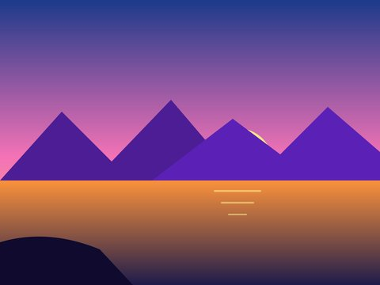
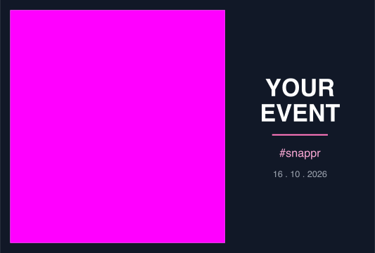
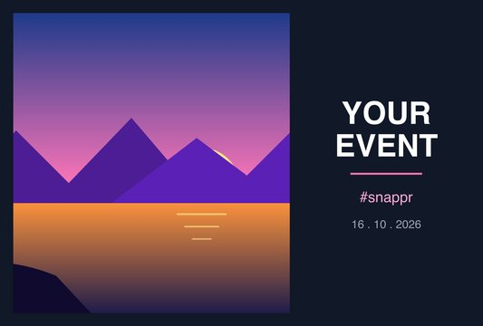
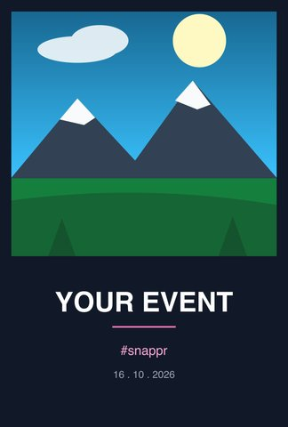
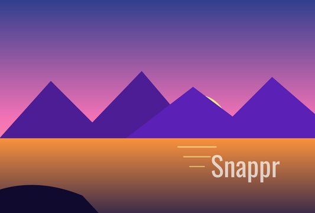
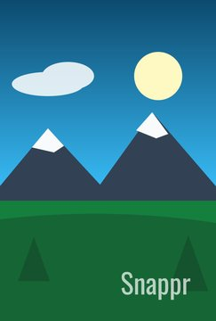

# 📸 snappr

**AirDrop-to-print photo kiosk for macOS.** Guests AirDrop a photo to the Mac,
snappr crops it to the photo paper, frames it in your event's branded overlay,
and hands you a print-ready file. No editing, no review queue: drop, print, done.

<p align="center">
  
  &nbsp;➡️&nbsp;
  
  &nbsp;➡️&nbsp;
  
</p>

<p align="center"><sub>the guest's photo &nbsp;·&nbsp; your design, with a magenta window &nbsp;·&nbsp; the print</sub></p>

---

## ✨ What it does

1. 📲 **A photo arrives.** AirDrop drops HEIC or JPEG into `~/Downloads`. snappr
   watches that folder and waits until the transfer has really finished.
2. ✂️ **It is cropped to the paper.** The largest rectangle of the paper's shape
   (100 x 148 mm by default) is cut from the middle of the photo. Landscape photos
   get a landscape print, portrait photos a portrait one.
3. 🎨 **It is framed in your overlay.** You draw the branding as an SVG and mark
   where the photo goes with a magenta (`#FF00FF`) shape. snappr fits the photo
   into that window and composites your artwork on top.
4. 🖨️ **You print it.** The result is written as `IMG_1234.overlay.png` right
   next to the original, and the app shows it in a filmstrip, one click from the
   printer.

Each orientation has its own design:

<p align="center">
  
  &nbsp;&nbsp;
  
</p>

## 💎 The photo stays lossless

Cropping is the only step that throws pixels away. Everything after it is
bit-for-bit lossless, and the test suite proves it:

- 🧮 **Never resampled.** The canvas is sized from the photo so the fit is
  exactly 1:1. No scaling, no upscaling.
- 🎚️ **Bit depth follows the source.** A 10-bit iPhone HEIC comes out as a
  16-bit PNG; an 8-bit JPEG stays 8-bit.
- 🌈 **Colour is preserved.** The ICC profile (Display P3 on iPhones) is kept,
  and the overlay is converted into the photo's colour space before compositing,
  so your brand colours print correctly.
- 🧾 **Metadata survives.** Resolution and EXIF are carried through to the print.
- ✅ **Verified.** Wherever your overlay is transparent, the output is
  bit-identical to the source.

## 🖥️ The desktop app

**Snappr.app** is a Tauri app with a React UI around the Rust pipeline:

- 🎞️ **Filmstrip** of every photo that arrived, with a blue dot on the ones you
  have not looked at yet and a marker on the ones already printed
- 🖼️ **Overlay panel**: your library of designs, each with a landscape and a
  portrait toggle, and a live preview of where the photo window lands
- 👀 **Watch toggle** to pause and resume the drop folder
- 🖨️ **Native macOS print** and the system **share sheet**
- 🫳 **Drag and drop** photos onto the window or the Dock icon to process them
  without AirDrop
- 💾 **Survives a restart**: the filmstrip is remembered, so a crash halfway
  through an event does not lose what was already printed

A sample overlay ships for both orientations, so the very first photo already
shows something:

<p align="center">
  
  &nbsp;&nbsp;
  
</p>

## 🎨 Designing an overlay

Draw it in Figma, Illustrator, Inkscape or by hand. Three rules:

1. 🟪 **Mark the photo window with a `#FF00FF` shape.** Any element, any nesting,
   any transform. It is never printed; it only tells snappr where the photo goes.
   Leave the area under it transparent so the photo shows through.
2. 📐 **Draw at the paper's shape**: 1.48:1 for landscape (e.g. 2960 x 2000),
   1:1.48 for portrait (2000 x 2960).
3. 🔲 **Keep a `viewBox`**, or an absolute `width` and `height`. Exporters do this
   by default.

`docs/examples/` has the event designs used in the pictures above, and `sample/`
has the full-frame watermark that ships with the app.

> 💡 A good convention: give the branding 2/5 of the frame along its long side,
> as a right-hand panel in landscape and a bottom band in portrait.

## 🚀 Getting started

You need macOS, [Rust](https://rustup.rs) 1.77+, Node.js and libvips.
[mise](https://mise.jdx.dev) is optional but gives you the short task names.

```sh
brew install vips
npm install
```

### Run the app

```sh
mise run dev            # or: npm run tauri dev
```

A debug build links Homebrew's libvips, so this works on a fresh clone.

### Build Snappr.app

```sh
mise run runtime        # build libvips 8.18.4 from source and bundle its dylibs
mise run app            # build Snappr.app with that libvips inside
mise run install        # build it and copy it into ~/Applications
```

A release build ships its own libvips, so the finished app does not need
Homebrew. See [`docs/bundled-runtime.md`](docs/bundled-runtime.md).

### Use the command line

```sh
mise run watch                     # watch ~/Downloads and overlay each new photo
mise run overlay IMG_1234.heic     # overlay these photos now, then open them
mise run inspect IMG_1234.heic     # what libvips makes of a file, as JSON
```

The CLI reads `~/.config/snappr/config.toml`. Every key has a default, so a
missing file is a working configuration:

```toml
background = "#ffffff"
open_after = true

[print]
short_mm = 100
long_mm = 148

[overlay]
landscape = "~/Designs/event-landscape.svg"
portrait  = "~/Designs/event-portrait.svg"
```

## 🛡️ Your Downloads folder is safe

snappr treats `~/Downloads` as read-only apart from the one file it adds. It
never moves, renames or deletes anything there, does not create folders and
ignores files it does not recognise. Clearing a photo from the filmstrip
deletes nothing you can see; the original and the print stay where they are.

Guest photos come from strangers, so libvips's untrusted loaders stay blocked.
Only the SVG loader your overlays need is allowed.

## 🧪 Tests

```sh
mise run test          # the whole suite
mise run test-live     # watcher tests that drive real filesystem events
```

## 🗂️ Repository layout

| path | what |
|---|---|
| `crates/snappr-core` | 🦀 the pipeline: watcher, crop, overlay, composite, previews |
| `crates/snappr-cli` | ⌨️ the command line |
| `src-tauri` | 🖥️ the desktop app shell |
| `src` | ⚛️ the React UI (Radix Themes) |
| `crates/xtask` | 🔧 build tasks for the bundled libvips |
| `sample` | 🖼️ the overlays that ship with the app |
| `docs` | 📚 deeper write-ups of the app and the bundled runtime |

The design decisions, and the measurements behind them, are in
[`CLAUDE.md`](CLAUDE.md), [`docs/desktop-app.md`](docs/desktop-app.md) and
[`docs/bundled-runtime.md`](docs/bundled-runtime.md).

## 📄 License

[MIT](LICENSE) © Freevision s.r.o.
